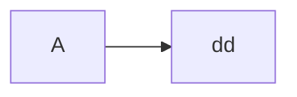

# 줄바꿈
.md - 마크다운
마크다운은 엔터가 줄바꿈이 아님

엔터를 두번 써야 다른문단으로 인식

공백 두번(__)+ 엔터 면  
같은 문단 내 줄바꿈으로 인식

이것도<br> 줄바꿈

# 제목

#바로붙으면. #다음 숫자를 붙여서 이슈 호출이나 연관 기능  
옵시디언, 메모 앱들은 #다음으로 태그로 씀  
(노션,슬랙,디스코드)

## 제목2
### 제목3
- 일반적인 국가적 룰.

(일반적으로 #,##은 구분선을 사용해서 제목과 부제목을 의미)

_____
순서 없는 리스트
- 순서가 없음  
    -ㄱ  
    -ㄷ  
    -ㅇ  
탭 등을 사용한 들여쓰기  
    *?

순서 있는 리스트

    1. 1
    2. 2
    3. 3
<!-- ctrl + / 주석부르기 -->

[]체크박스? github issue, redme 해석시 특수문법
 - [x] 이게 체크 된것

 *기울이기* _기울이기_  
 **진하게** __진하게__  
 ***기울면서 진하게*** ___이것도___


 ~~취소선~~  
  <mark>형광펜 태그</mark>

` ~~취소선~~`
`\`\- 인라인코드


```python
print("Hello World")
```




>인용
>>인용인용
>>>인용인용인용

>\-이스케이프?

<!-- \- 이스케이프 문자 -->